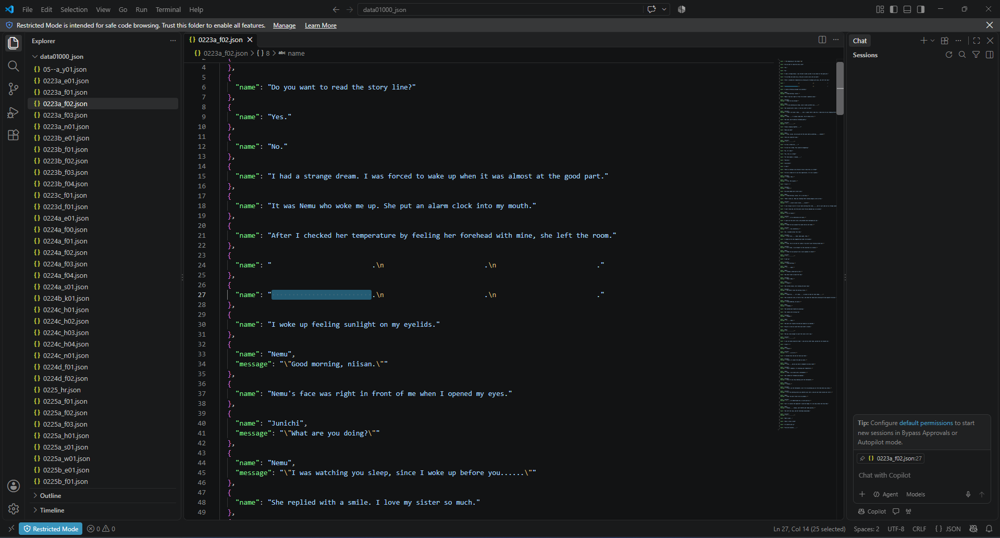
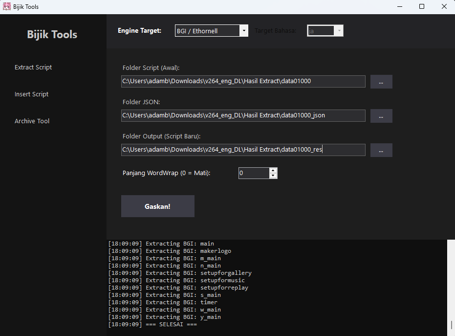
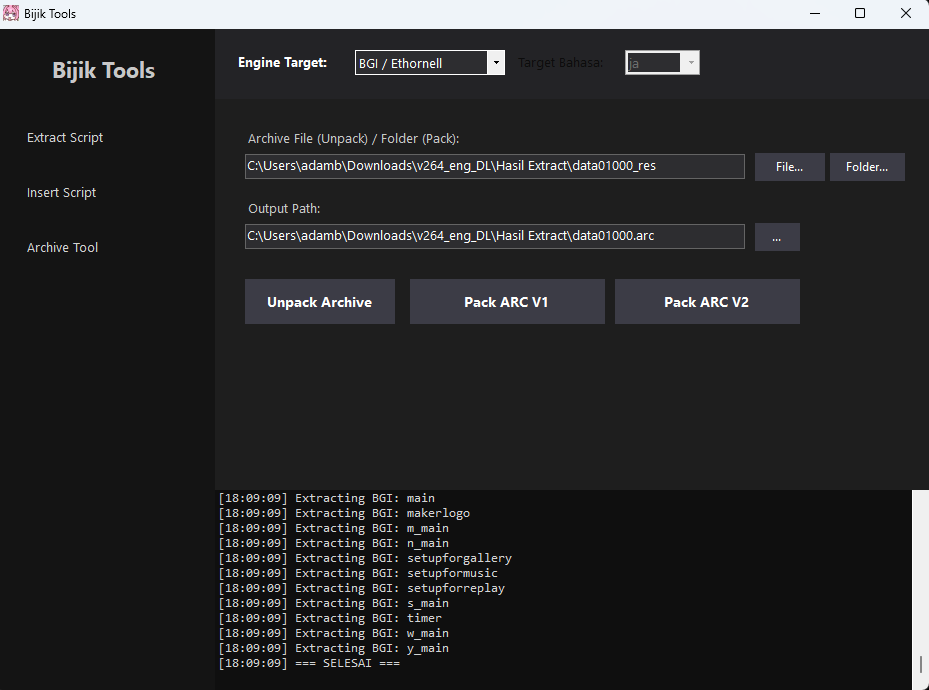

# Da Capo Patch Tools

Kumpulan tools dan berkas kerja untuk patch serta penerjemahan **Da Capo** pada engine **BGI / Ethornell**, dikelola oleh **Sakura Symphony Re;Translation**.

Repository ini menyimpan paket BijikTools, arsip skenario dan sistem, database BGI, serta data pengguna. Panduan di bawah mengikuti alur **unpack arsip → extract JSON → cadangkan arsip asli → terjemahkan → insert script → pack ARC V1 → pasang hasil ke game**.

## Isi repository

| Berkas | Keterangan |
| --- | --- |
| `BijikTools-v0.5beta1-fixed.rar` | Distribusi biner BijikTools v0.5beta1-fixed, termasuk executable Windows, library pendukung, dan beberapa tool eksternal. |
| `data01000.arc` | Arsip `PackFile` berisi 678 entri bernama skenario. Berkas kerja ini berbeda dari salinan `.bak`. |
| `data01000.bak` | Salinan cadangan arsip `PackFile` dengan 678 entri. Statusnya sebagai arsip game asli yang belum dimodifikasi belum diverifikasi. |
| `system.arc` | Arsip sistem berisi 5 entri: `ipl._bp`, `kettei`, `launcher._bp`, `sentaku`, dan `test_voice`. Untuk pemasangan, langsung salin berkas dari repository ini ke folder game. |
| `BGI.gdb` | Berkas database BGI dengan signature `SDC FORMAT 1.00`. |
| `UserData/DC101.sud` | Data pengguna dari sesi game, yang juga memuat teks berbahasa Indonesia. Disimpan sebagai bagian dari folder kerja; tidak diperlukan untuk mengekstrak BijikTools. |

Paket BijikTools menyertakan `BijikTools.exe`, `BijikTools.dll`, `BijikTools.original.dll`, serta komponen eksternal seperti EntisDecryptTool, Rosetta, dan tjs2-decompiler. Source code utama BijikTools tidak tersedia di repository ini.

## Struktur folder dan alur kerja

Struktur berikut mengikuti berkas yang tersedia di GitHub. Folder bertanda **lokal** dibuat sendiri setelah mengunduh repository atau menjalankan BijikTools.

```text
Da-Capo-Patch-Tools/
├── .gitattributes
├── .gitignore
├── README.md
├── BijikTools-v0.5beta1-fixed.rar
├── BGI.gdb
├── data01000.arc                 # arsip skenario yang tersedia di repository
├── data01000.bak                 # salinan cadangan yang tersedia di repository
├── system.arc                   # langsung disalin ke folder game
├── UserData/
│   └── DC101.sud
├── docs/
│   └── images/                  # gambar panduan BijikTools
├── BijikTools-v0.5beta1-fixed/    # lokal: hasil ekstraksi paket tools
│   ├── BijikTools.exe
│   └── ...
└── work/                        # lokal: bahan dan hasil pengerjaan
    ├── data01000_original.arc    # cadangan dari langkah 3
    ├── data01000/               # script hasil unpack dari langkah 1
    ├── data01000_json/          # JSON untuk diterjemahkan pada langkah 2–4
    ├── data01000res/            # script format game dari langkah 5
    └── data01000.arc            # arsip hasil Pack ARC V1 dari langkah 6
```

Contoh path dalam panduan menggunakan `C:\DaCapo\Da-Capo-Patch-Tools` sebagai folder repository. Sesuaikan dengan lokasi unduhan atau clone Anda. Seluruh proses skenario dikerjakan di dalam `work` agar sumber dan hasil setiap tahap mudah ditemukan.

```text
work\data01000.arc
  → Unpack Archive → work\data01000
  → Extract Script → work\data01000_json
  → edit terjemahan
  → Insert Script  → work\data01000res
  → Pack ARC V1    → work\data01000.arc
```

Sebelum pack, arsip input di `work` sudah diubah namanya menjadi `data01000_original.arc` pada langkah 3. Dengan begitu, nama `data01000.arc` tersedia untuk arsip hasil terjemahan.

## Persyaratan

- Windows.
- **.NET 8 Desktop Runtime**. Konfigurasi runtime BijikTools menargetkan `net8.0` serta `Microsoft.NETCore.App` dan `Microsoft.WindowsDesktop.App` versi 8.0.
- 7-Zip atau WinRAR untuk mengekstrak paket `.rar`.
- Instalasi game Da Capo yang sesuai dengan berkas kerja ini untuk pengujian patch.

## Persiapan

1. Unduh repository melalui **Code > Download ZIP**, atau gunakan Git:

   ```powershell
   git clone https://github.com/SakuraSymphonyReTranslation/Da-Capo-Patch-Tools.git
   cd Da-Capo-Patch-Tools
   ```

2. Ekstrak `BijikTools-v0.5beta1-fixed.rar` dengan seluruh isinya. Pertahankan DLL dan folder `external` bersama executable.
3. Pasang .NET 8 Desktop Runtime bila belum tersedia, lalu jalankan `BijikTools.exe` dari folder hasil ekstraksi.
4. Buat folder `work` di dalam folder repository. Untuk menerjemahkan dari arsip game asli, salin `data01000.arc` dari instalasi game Anda ke `work\data01000.arc`. Jika ingin melanjutkan berkas kerja yang tersedia di repository, salin `data01000.arc` dari root repository ke folder `work` tersebut.
5. Ikuti enam langkah BijikTools di bawah, lalu terapkan hasilnya sesuai bagian **Pemasangan ke game**. Arsip skenario dari repository dan berkas `.bak` belum dipastikan sebagai salinan game asli yang bersih; gunakan sumber dari instalasi Anda bila membutuhkan arsip asli.

## Panduan BijikTools

**Gunakan `Engine Target`: `BGI / Ethornell` selama proses unpack, extract, insert, dan pack.** Nama folder input dan output harus konsisten dari satu langkah ke langkah berikutnya.

### Langkah 1: Unpack `data01000.arc` ke folder `data01000`

**Pastikan `Engine Target` dipilih sebagai `BGI / Ethornell`.**

1. Buka menu **Archive Tool** di sisi kiri BijikTools.
2. Pada **Archive File (Unpack) / Folder (Pack)**, klik **File...** dan pilih berkas `data01000.arc` yang akan diekstrak.
3. Pada **Output Path**, isi lokasi folder tujuan bernama `data01000`, tanpa ekstensi `.arc`. Contoh pasangan input dan output:

   ```text
   Input : C:\DaCapo\Da-Capo-Patch-Tools\work\data01000.arc
   Output: C:\DaCapo\Da-Capo-Patch-Tools\work\data01000
   ```

4. Klik **Unpack Archive**.
5. Tunggu sampai log menampilkan `=== SELESAI ===`, lalu periksa folder `data01000`. Berkas hasil unpack harus berada di dalam folder tersebut.


Gambar menunjukkan pengaturan BijikTools pada folder kerja pengguna. Gunakan path contoh di panduan ini atau sesuaikan dengan lokasi folder Anda.

### Langkah 2: Extract script dari `data01000` menjadi JSON di `data01000_json`

**Tetap gunakan `Engine Target`: `BGI / Ethornell`.** Gunakan folder `data01000` hasil unpack pada langkah pertama sebagai input.

1. Buka menu **Extract Script** di sisi kiri BijikTools.
2. Pada **Folder Script (Input)**, pilih folder `data01000` yang berisi berkas hasil unpack.
3. Pada **Folder Output (json)**, pilih lokasi folder terpisah bernama `data01000_json`. Contoh pasangan input dan output:

   ```text
   Input : C:\DaCapo\Da-Capo-Patch-Tools\work\data01000
   Output: C:\DaCapo\Da-Capo-Patch-Tools\work\data01000_json
   ```

4. Klik **Gas Extract!** untuk mengonversi script dari folder input menjadi berkas JSON di folder output.
5. Tunggu sampai proses selesai, lalu periksa berkas JSON di dalam `data01000_json`. Folder `data01000` digunakan untuk script hasil unpack, sedangkan `data01000_json` digunakan untuk hasil konversi JSON.


### Langkah 3: Rename arsip asli menjadi `data01000_original.arc`

Setelah unpack dan ekstraksi JSON selesai, ubah nama arsip input `work\data01000.arc` yang digunakan pada langkah pertama menjadi **`work\data01000_original.arc`**. Simpan berkas tersebut sebagai cadangan sumber saat membuat arsip hasil patch. Cadangan ini berasal dari arsip yang Anda pilih pada persiapan; mengganti nama berkas tidak mengubah isinya.

```text
Sebelum: C:\DaCapo\Da-Capo-Patch-Tools\work\data01000.arc
Sesudah: C:\DaCapo\Da-Capo-Patch-Tools\work\data01000_original.arc
```

Folder hasil unpack tetap bernama `data01000`, dan folder hasil ekstraksi JSON tetap bernama `data01000_json`.

### Langkah 4: Edit JSON untuk menerjemahkan teks

**Format JSON disarankan untuk mengedit dan menerjemahkan teks script.** Buka folder `work\data01000_json` di editor teks seperti Visual Studio Code, lalu buka berkas `.json` yang ingin diterjemahkan, misalnya `0223a_f02.json`.

1. Terjemahkan nilai teks sesuai konteks. Pada hasil ekstraksi yang ditunjukkan, `name` dapat berisi narasi atau pilihan, sedangkan objek dialog dapat memiliki `name` untuk nama pembicara dan `message` untuk isi dialog.
2. Pertahankan nama key, urutan dan jumlah entri, serta struktur JSON. Perhatikan tanda kutip, koma, dan escape seperti `\n` atau `\"` agar berkas tetap valid.
3. Periksa teks yang memiliki spasi berlebih secara cermat dan rapikan manual bila diperlukan. Contoh entri yang perlu diperiksa:

   ```json
   [
     {
       "name": "                         .\n                         .\n                         ."
     },
     {
       "name": "                         .\n                         .\n                         ."
     }
   ]
   ```

   Jika spasi tersebut tidak diperlukan untuk tampilan teks, hapus spasi berlebih di dalam nilainya. Contoh hasil perapian dengan titik dan pergantian baris tetap dipertahankan:

   ```json
   [
     {
       "name": ".\n.\n."
     },
     {
       "name": ".\n.\n."
     }
   ]
   ```

   Periksa juga entri yang hanya berisi spasi atau pergantian baris. Tentukan perbaikannya berdasarkan konteks dan tampilan di game; jangan menghapus semua spasi atau entri secara massal.
4. Simpan hasil terjemahan di folder `data01000_json` dan pastikan editor tidak melaporkan kesalahan sintaks JSON.



### Langkah 5: Insert JSON menjadi script game di `data01000res`

Setelah JSON selesai diterjemahkan, gunakan **Insert Script** untuk memasukkan teks ke script awal dan menghasilkan berkas dalam format asli game. Folder `data01000res` menjadi sumber untuk pack pada langkah berikutnya.

1. Buka menu **Insert Script** di sisi kiri BijikTools dan pastikan engine tetap **BGI / Ethornell**.
2. Pada **Folder Script (Awal)**, pilih `work\data01000`, yaitu script hasil unpack pada langkah 1.
3. Pada **Folder JSON**, pilih `work\data01000_json` yang berisi JSON hasil terjemahan.
4. Pada **Folder Output (Script Baru)**, pilih folder terpisah `work\data01000res`. Contoh pengaturan lengkap:

   ```text
   Folder Script (Awal)       : C:\DaCapo\Da-Capo-Patch-Tools\work\data01000
   Folder JSON               : C:\DaCapo\Da-Capo-Patch-Tools\work\data01000_json
   Folder Output (Script Baru): C:\DaCapo\Da-Capo-Patch-Tools\work\data01000res
   ```

5. Untuk mengikuti pengaturan pada gambar, biarkan **Panjang WordWrap (0 = Mati)** bernilai `0`.
6. Klik **Gaskan!**, tunggu sampai proses insert selesai, lalu periksa log untuk memastikan tidak ada kegagalan. Folder `data01000res` harus berisi script dalam format game yang siap dipack.



Pada gambar, folder hasil diberi nama `data01000_res`. Panduan ini menggunakan `data01000res` sesuai alur yang diminta; keduanya adalah nama folder pilihan pengguna. Gunakan nama yang sama pada output langkah 5 dan input langkah 6.

### Langkah 6: Pack `data01000res` menjadi `data01000.arc`

1. Buka menu **Archive Tool** dan pastikan **Engine Target** tetap **BGI / Ethornell**.
2. Pada **Archive File (Unpack) / Folder (Pack)**, klik **Folder...** dan pilih folder `work\data01000res` hasil langkah 5.
3. Pada **Output Path**, isi path berkas `work\data01000.arc`, termasuk ekstensi `.arc`:

   ```text
   Input : C:\DaCapo\Da-Capo-Patch-Tools\work\data01000res
   Output: C:\DaCapo\Da-Capo-Patch-Tools\work\data01000.arc
   ```

4. Klik **Pack ARC V1**.
5. Tunggu sampai proses pack selesai, periksa log untuk memastikan tidak ada kegagalan, lalu pastikan berkas `work\data01000.arc` terbentuk. Berkas inilah yang digunakan untuk memasang skenario hasil terjemahan.



## Pemasangan ke game

1. Tutup game dan cadangkan `data01000.arc` serta `system.arc` yang ada di folder instalasi game ke folder cadangan terpisah.
2. Salin **`work\data01000.arc` hasil langkah 6** ke folder game yang memuat arsip bernama sama, lalu timpa `data01000.arc` lama.
3. Salin **`system.arc` dari root repository GitHub ini** ke folder game tersebut, lalu timpa `system.arc` lama. `system.arc` sudah disediakan untuk langsung digunakan dan tidak perlu diedit atau dipack ulang.
4. Jalankan game, lalu periksa pemuatan skenario, tampilan teks dan pergantian baris, pilihan dialog, serta fungsi save/load.

```text
Da-Capo-Patch-Tools\work\data01000.arc → <folder game>\data01000.arc
Da-Capo-Patch-Tools\system.arc         → <folder game>\system.arc
```

Jika ingin menggunakan arsip skenario yang sudah tersedia di repository tanpa membuat terjemahan sendiri, gunakan `data01000.arc` dari root repository sebagai sumber salinan pada langkah pemasangan 2.

`BGI.gdb`, `data01000.bak`, dan `UserData/DC101.sud` disimpan sebagai bahan kerja tambahan; ketiganya tidak digunakan dalam enam langkah BijikTools di atas. Folder `work`, hasil ekstraksi tools, dan cadangan lokal tidak perlu diunggah untuk mengikuti panduan ini.

## Status dan batas kompatibilitas

- Integritas paket `.rar` telah diperiksa dengan 7-Zip.
- Header arsip dan jumlah entri telah diperiksa secara statis.
- Enam langkah BijikTools dan cara pemasangan didokumentasikan berdasarkan instruksi serta gambar dari pengguna. Gambar pengaturan insert dan pack tidak menjadi bukti bahwa kedua proses tersebut sudah selesai.
- `data01000.arc` dan `data01000.bak` memiliki ukuran serta hash yang berbeda.
- BijikTools dan berkas patch **belum diuji berjalan di dalam game** dalam proses persiapan repository ini.
- Edisi dan build game yang tepat belum diidentifikasi; kompatibilitas dengan edisi Da Capo lain tidak diasumsikan.
- Keberadaan teks Indonesia di data pengguna tidak membuktikan bahwa seluruh skenario sudah diterjemahkan.

## Atribusi

Pemeliharaan kumpulan berkas: [SakuraSymphonyReTranslation](https://github.com/SakuraSymphonyReTranslation).

BijikTools, komponen eksternal, dan aset game merupakan karya pemilik masing-masing. Repository ini tidak menetapkan lisensi baru untuk komponen pihak ketiga atau aset game. Informasi lisensi yang tersedia pada distribusi asal tetap berlaku.
