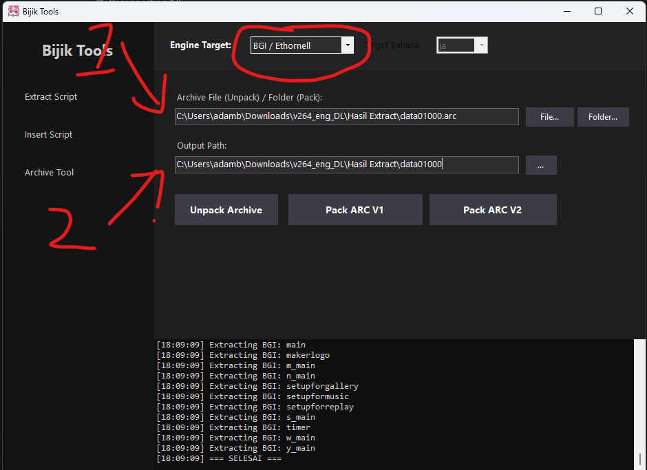
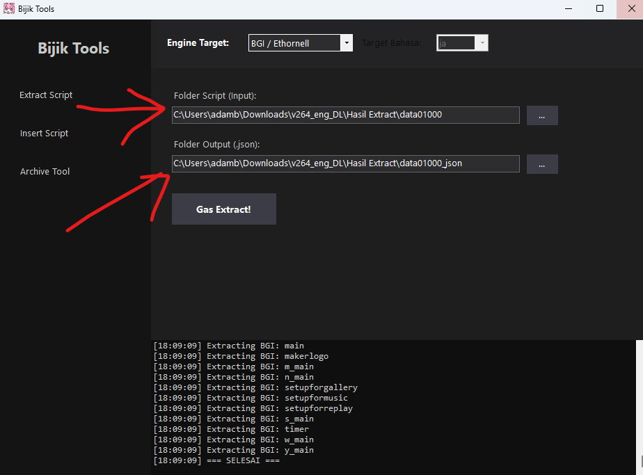

# Da Capo Patch Tools

Kumpulan tools dan berkas kerja untuk eksperimen patch serta penerjemahan **Da Capo** pada engine **BGI / Ethornell**, dikelola oleh **Sakura Symphony Re;Translation**.

Repository ini menyimpan paket BijikTools, arsip skenario, arsip sistem, database BGI, dan data pengguna dari folder kerja Da Capo Patch Tools. Berkas disertakan sebagaimana tersedia pada saat unggahan; ini merupakan kumpulan bahan kerja, bukan installer patch otomatis.

## Isi repository

| Berkas | Keterangan |
| --- | --- |
| `BijikTools-v0.5beta1-fixed.rar` | Distribusi biner BijikTools v0.5beta1-fixed, termasuk executable Windows, library pendukung, dan beberapa tool eksternal. |
| `data01000.arc` | Arsip `PackFile` berisi 678 entri bernama skenario. Berkas kerja ini berbeda dari salinan `.bak`. |
| `data01000.bak` | Salinan cadangan arsip `PackFile` dengan 678 entri. Statusnya sebagai arsip game asli yang belum dimodifikasi belum diverifikasi. |
| `system.arc` | Arsip `PackFile` berisi 5 entri: `ipl._bp`, `kettei`, `launcher._bp`, `sentaku`, dan `test_voice`. |
| `BGI.gdb` | Berkas database BGI dengan signature `SDC FORMAT 1.00`. |
| `UserData/DC101.sud` | Data pengguna dari sesi game, yang juga memuat teks berbahasa Indonesia. Disimpan sebagai bagian dari folder kerja; tidak diperlukan untuk mengekstrak BijikTools. |

Paket BijikTools menyertakan `BijikTools.exe`, `BijikTools.dll`, `BijikTools.original.dll`, serta komponen eksternal seperti EntisDecryptTool, Rosetta, dan tjs2-decompiler. Source code utama BijikTools tidak tersedia di repository ini.

## Persyaratan

- Windows.
- **.NET 8 Desktop Runtime**. Konfigurasi runtime BijikTools menargetkan `net8.0` serta `Microsoft.NETCore.App` dan `Microsoft.WindowsDesktop.App` versi 8.0.
- 7-Zip atau WinRAR untuk mengekstrak paket `.rar`.
- Instalasi game Da Capo yang sesuai dengan berkas kerja ini untuk pengujian patch.

## Penggunaan dasar

1. Unduh repository melalui **Code > Download ZIP**, atau gunakan Git:

   ```powershell
   git clone https://github.com/SakuraSymphonyReTranslation/Da-Capo-Patch-Tools.git
   cd Da-Capo-Patch-Tools
   ```

2. Ekstrak `BijikTools-v0.5beta1-fixed.rar` dengan seluruh isinya. Pertahankan DLL dan folder `external` bersama executable.
3. Pasang .NET 8 Desktop Runtime bila belum tersedia, lalu jalankan `BijikTools.exe` dari folder hasil ekstraksi.
4. Buat salinan arsip dan database sebelum mengedit, lalu ikuti panduan di bawah untuk unpack `data01000.arc` dan mengekstrak script menjadi JSON.
5. Untuk pengujian di game, tutup game terlebih dahulu dan cadangkan berkas yang akan diganti. Terapkan hasil kerja pada instalasi uji yang sesuai, lalu periksa pemuatan skenario, tampilan teks, pilihan dialog, dan fungsi save/load.

## Panduan BijikTools

### Langkah 1: Unpack `data01000.arc` ke folder `data01000`

**Pastikan `Engine Target` dipilih sebagai `BGI / Ethornell`.**

1. Buka menu **Archive Tool** di sisi kiri BijikTools.
2. Pada **Archive File (Unpack) / Folder (Pack)**, klik **File...** dan pilih berkas `data01000.arc` yang akan diekstrak.
3. Pada **Output Path**, isi lokasi folder tujuan bernama `data01000`, tanpa ekstensi `.arc`. Contoh pasangan input dan output:

   ```text
   Input : C:\DaCapo\Hasil Extract\data01000.arc
   Output: C:\DaCapo\Hasil Extract\data01000
   ```

4. Klik **Unpack Archive**.
5. Tunggu sampai log menampilkan `=== SELESAI ===`, lalu periksa folder `data01000`. Berkas hasil unpack harus berada di dalam folder tersebut.



Gambar panduan menunjukkan pilihan engine, lokasi arsip input, dan folder output. Sesuaikan lokasi folder dengan instalasi atau folder kerja masing-masing.

### Langkah 2: Extract script dari `data01000` menjadi JSON di `data01000_json`

**Tetap gunakan `Engine Target`: `BGI / Ethornell`.** Gunakan folder `data01000` hasil unpack pada langkah pertama sebagai input.

1. Buka menu **Extract Script** di sisi kiri BijikTools.
2. Pada **Folder Script (Input)**, pilih folder `data01000` yang berisi berkas hasil unpack.
3. Pada **Folder Output (json)**, pilih lokasi folder terpisah bernama `data01000_json`. Contoh pasangan input dan output:

   ```text
   Input : C:\DaCapo\Hasil Extract\data01000
   Output: C:\DaCapo\Hasil Extract\data01000_json
   ```

4. Klik **Gas Extract!** untuk mengonversi script dari folder input menjadi berkas JSON di folder output.
5. Tunggu sampai proses selesai, lalu periksa berkas JSON di dalam `data01000_json`. Folder `data01000` digunakan untuk script hasil unpack, sedangkan `data01000_json` digunakan untuk hasil konversi JSON.



### Langkah 3: Rename arsip asli menjadi `data01000_original.arc`

Setelah unpack dan ekstraksi JSON selesai, ubah nama berkas `data01000.arc` asli yang digunakan pada langkah pertama menjadi **`data01000_original.arc`**. Simpan berkas tersebut sebagai cadangan agar arsip asli tetap tersedia saat membuat arsip hasil patch.

```text
Sebelum: data01000.arc
Sesudah: data01000_original.arc
```

Folder hasil unpack tetap bernama `data01000`, dan folder hasil ekstraksi JSON tetap bernama `data01000_json`.

Langkah unpack, ekstraksi JSON, dan pencadangan arsip ini didokumentasikan berdasarkan panduan pengguna. Parameter repack, encoding teks, dan cara pemasangan patch untuk build game tertentu belum didokumentasikan atau diuji dalam unggahan ini. Jangan menganggap berkas `.bak` sebagai cadangan bersih tanpa memeriksanya terlebih dahulu.

## Status dan batas kompatibilitas

- Integritas paket `.rar` telah diperiksa dengan 7-Zip.
- Header arsip dan jumlah entri telah diperiksa secara statis.
- `data01000.arc` dan `data01000.bak` memiliki ukuran serta hash yang berbeda.
- BijikTools dan berkas patch **belum diuji berjalan di dalam game** dalam proses persiapan repository ini.
- Edisi dan build game yang tepat belum diidentifikasi; kompatibilitas dengan edisi Da Capo lain tidak diasumsikan.
- Keberadaan teks Indonesia di data pengguna tidak membuktikan bahwa seluruh skenario sudah diterjemahkan.

## Atribusi

Pemeliharaan kumpulan berkas: [SakuraSymphonyReTranslation](https://github.com/SakuraSymphonyReTranslation).

BijikTools, komponen eksternal, dan aset game merupakan karya pemilik masing-masing. Repository ini tidak menetapkan lisensi baru untuk komponen pihak ketiga atau aset game. Informasi lisensi yang tersedia pada distribusi asal tetap berlaku.
